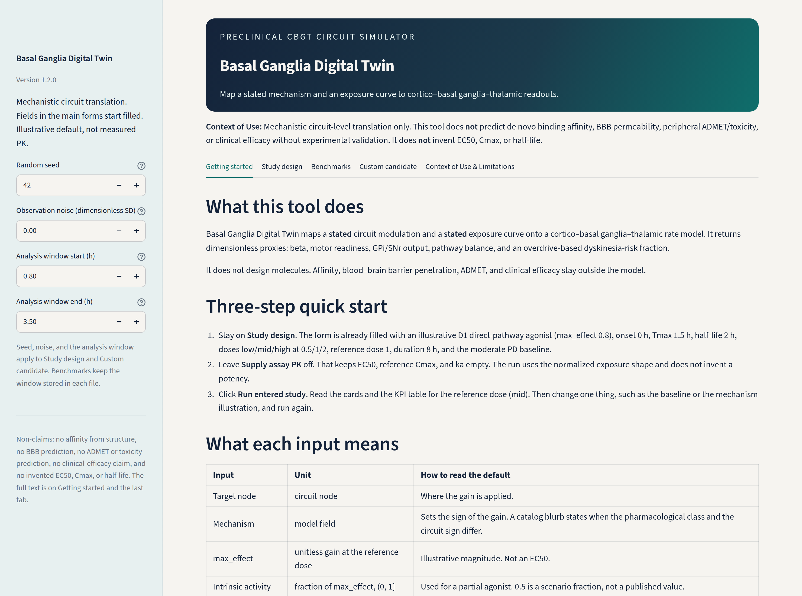
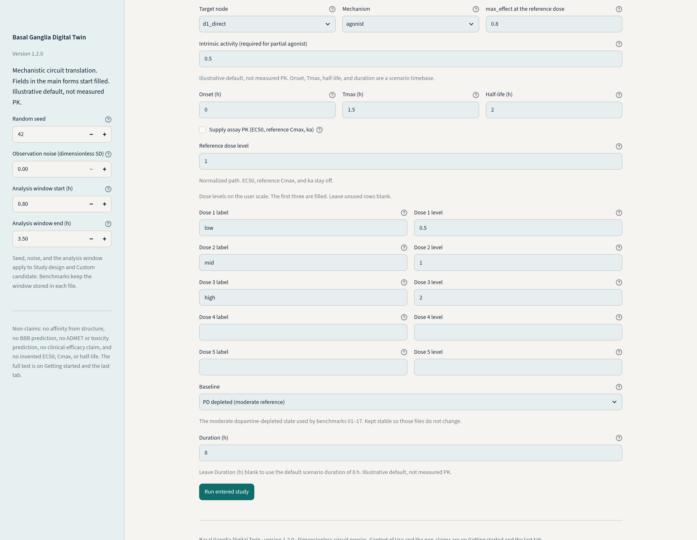
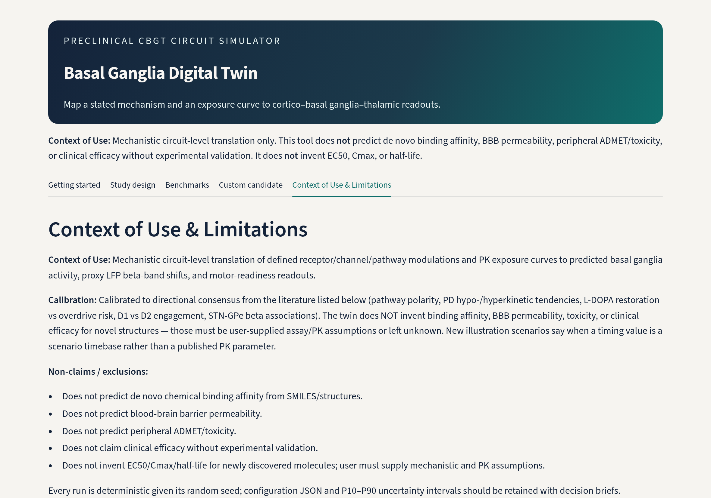
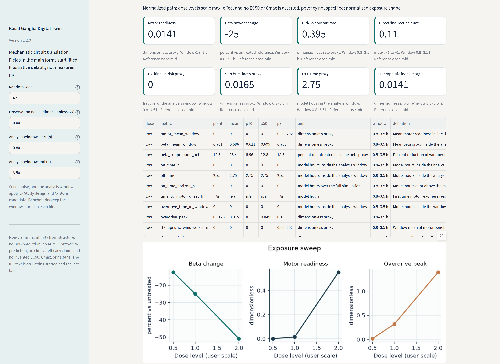

<h1 align="center">Basal Ganglia Digital Twin</h1>

<p align="center">
  A preclinical cortico–basal ganglia–thalamic circuit simulator.<br>
  Map a defined target, a mechanism, and an exposure you supply to dimensionless circuit proxies.
</p>

<p align="center">
  <a href="LICENSE"></a>
  <a href="https://www.python.org/"></a>
  <a href="https://github.com/huhugyto177-hub/bg-digital-twin/actions/workflows/tests.yml"></a>
  <a href="https://bg-digital-twin-landing.vercel.app"></a>
</p>

<p align="center">
  <a href="https://bg-digital-twin-landing.vercel.app"><strong>Live demo</strong></a>
  ·
  <a href="#quick-start">Quick start</a>
  ·
  <a href="#context-of-use--non-claims">Context of use</a>
  ·
  <a href="#python-api">Python API</a>
  ·
  <a href="CONTRIBUTING.md">Contributing</a>
</p>

<p align="center">
  
</p>

<p align="center">
  
</p>

The screenshots are a local run of version 1.2.0. **Getting started** is the first tab. **Study design** opens with the illustrative defaults described below. The numbers on a results figure are dimensionless proxies from that run, not a measurement and not a claim of predictive accuracy.

The primary public entry is the landing page: <https://bg-digital-twin-landing.vercel.app>. The simulator is at `/app` on that host.

## Context of Use & non-claims

**Research use only. This is not medical advice, and it is not a clinical decision system.**

The simulator maps a **defined** receptor, channel, or pathway modulation, plus a **user-specified** exposure curve, onto a mean-field cortico–basal ganglia–thalamic circuit. It returns proxy activity, a proxy of beta-band local-field structure, motor-readiness and over-drive readouts, and the four derived proxies added in 1.2.0. Those readouts are dimensionless. They are not clinical scores, clinical ON/OFF time, a dyskinesia rating, or a reconstructed spectrum.

The same limits are in `configs/evidence_registry.yaml`, on **Getting started**, on the **Context of Use & Limitations** tab, and in every decision brief.

<p align="center">
  
</p>

This system does **not**:

- predict binding affinity from SMILES or any other structure, and it does not do structure-to-activity
- predict blood–brain barrier permeability
- predict ADMET or toxicity
- claim clinical efficacy
- invent EC50, Cmax, half-life, or any other PK number

If you have an assay EC50 or a measured exposure, turn on assay PK and enter it. If you do not, leave those fields off. Benchmarks `06`–`17` say `potency not specified; normalized exposure shape` unless a field in that file names a paper. Files `01`–`05` keep the numbers from the initial release, including EC50 and Cmax where those files contain them. The app notes that the EC50 and Cmax in file `03` were not re-verified as published PK. Treat every potency and PK field as a scenario input stored in YAML, not as a quantity the model discovered.

## Why this exists

Preclinical pharmacology and electrophysiology groups often have a mechanism they can name (which node, which sign, how large a gain) and an exposure curve they are willing to assume. What they lack is a small, inspectable circuit picture of what that combination does to direct, indirect, and hyperdirect pathways before an animal study is designed.

This repository is that picture for one circuit. It is a mean-field rate model with a drug-free steady state, a user-supplied exposure envelope, and readouts that stay in model units. It is not a chemistry model and not a digital patient.

## Key features

- Seven baselines. `healthy` and `pd_depleted` are the original pair. `pd_depleted` is the moderate reference behind benchmarks `01`–`17`. The others are directional sketches: mild PD, advanced PD, LID-prone, Huntington-like indirect-pathway loss, and dystonia-like lost surround.
- Six target nodes and six circuit mechanisms. A partial agonist requires an intrinsic activity you supply. A PAM gain is scaled by baseline dopamine tone. Some catalog illustrations use `nam` as the circuit sign even when the pharmacology is an agonist or a PAM. The blurb on each one says so.
- An empirical PK envelope: onset, Tmax, half-life, optional Cmax, optional absorption rate, and repeat dosing. The curve is an input, not a prediction.
- A study-design sweep of 3–5 doses, an inverted-U flag, and P10–P90 bands from Latin-hypercube draws. The form opens prefilled with illustrative defaults.
- Seventeen benchmark files. `01`–`05` are the original scenarios. `06`–`17` are mechanistic illustrations. Pull request #3 did not change those files.
- Readouts for beta, motor readiness, ON/OFF time, over-drive, plus `dyskinesia_risk_proxy`, `gpi_snr_output_rate`, `stn_burstiness_proxy`, and `direct_indirect_balance_index`.
- The same run from the Streamlit app or from the Python API, deterministic given the seed.
- A Markdown and PDF decision brief, plus CSV and JSON downloads.
- An evidence registry in which each entry has a DOI or a PMID.

## What's modeled

The state vector is cortex, D1-MSN, D2-MSN, GPe, STN, GPi/SNr, and thalamus. Integration uses `scipy.integrate.solve_ivp`. Simulations start at the drug-free steady state of the selected baseline, so time zero is that untreated state, not a startup transient.

### Baselines

`dopamine_tone` is a model parameter on a 0–2 scale. It is not a measured tissue concentration. The mild, advanced, LID-prone, Huntington-like, and dystonia-like files are scenario levels ordered by a directional prior, not a fitted staging scale.

| Preset | File | Configured `dopamine_tone` | Role |
| --- | --- | --- | --- |
| `healthy` | `configs/baseline_healthy.yaml` | 1.0 | Drug-free healthy parameter set |
| `pd_mild` | `configs/baseline_pd_mild.yaml` | 0.78 | Partial dopamine loss between healthy and the moderate reference |
| `pd_depleted` | `configs/disease_pd_depleted.yaml` | 0.22 | Moderate reference used by benchmarks `01`–`17` |
| `pd_advanced` | `configs/baseline_pd_advanced.yaml` | 0.08 | More severe dopamine loss than `pd_depleted` |
| `lid_prone` | `configs/baseline_lid_prone.yaml` | 0.24 | Depleted tone with a sensitized direct pathway |
| `hd_indirect_loss` | `configs/baseline_hd_indirect_loss.yaml` | 0.9 | Early Huntington-like loss of indirect-pathway drive. Dopamine tone is not the lesion |
| `dystonia_surround` | `configs/baseline_dystonia_surround.yaml` | 0.85 | Weaker surround inhibition, without a parkinsonian beta elevation |

Essential tremor is not a baseline. The rate skeleton here does not represent a cerebello–thalamic oscillator.

The untreated ordering locked by the tests, and only as a property of these parameter files: window-mean beta rises from healthy to mild to `pd_depleted` to advanced, and window-mean motor readiness falls from healthy to mild to `pd_depleted`. Advanced GPi/SNr output is higher than the moderate reference. The Huntington-like and dystonia-like sketches raise motor readiness and lower the indirect term relative to healthy. That ordering is not a clinical staging result.

### Targets and mechanisms

| Target node | What the gain does |
| --- | --- |
| `dopamine_tone` | Adds to the baseline dopaminergic tone |
| `d1_direct` | Direct-pathway D1-MSN gain |
| `d2_indirect` | Indirect-pathway D2-MSN gain |
| `stn_hyperdirect` | Hyperdirect STN gain |
| `gpe` | GPe modulation |
| `gpi_snr` | GPi/SNr modulation |

| Mechanism | Sign | Extra rule |
| --- | --- | --- |
| `agonist` | positive | |
| `partial_agonist` | positive | Multiplied by `intrinsic_activity` in `(0, 1]`, which you supply |
| `pam` | positive | Multiplied by baseline dopamine tone, clipped to `[0, 1]` |
| `antagonist` | negative | |
| `nam` | negative | |
| `channel_blocker` | negative | |

If `ec50_nM` and `cmax_nM` are both set, the effect follows a Hill occupancy of the concentration curve. Otherwise the effect follows the shape of the exposure curve scaled by `max_effect`, and the file should say that potency is not specified.

### Mechanism illustrations

These mappings sit on the nodes above. Magnitudes are the illustrative defaults in `src/catalog.py`. None of them asserts an EC50, a Cmax, or a published half-life. The form timebase is onset 0 h, Tmax 1.5 h, half-life 2 h.

| Illustration | Node and circuit field | Why that sign | Registry id |
| --- | --- | --- | --- |
| D1 direct-pathway agonist | `d1_direct` agonist, max_effect 0.8 | Positive direct-pathway gain | `gerfen_surmeier_2011` |
| mGluR5 NAM | `stn_hyperdirect` NAM, max_effect 0.6 | Less glutamatergic drive at STN | `conn_2005_mglu` |
| 5-HT1A agonist | `dopamine_tone` NAM, max_effect 0.35 | Less dopamine release from serotonin terminals. The NAM field is the circuit sign, not the receptor class | `carta_2007_5ht` |
| Muscarinic M4 PAM | `d1_direct` NAM, max_effect 0.45 | M4 PAM reduces direct-pathway potentiation. The model field carries that negative gain | `shen_2015_m4` |
| GABA-A facilitation in GPi/SNr | `gpi_snr` NAM, max_effect 0.5 | Focal GABA-A agonism lowers GPi output, so the node gain is negative | `baron_2002_gaba_gpi` |
| Adenosine A2A antagonist | `d2_indirect` agonist, max_effect 0.7 | Same gain sign as benchmark `11` | `schwarzschild_2006` |

The study-design presets for L-DOPA reference, D1 PAM, D1 partial agonist, D2/D3 modulator, and GPR6 inverse agonist are still the benchmark files `06`, `16`, `15`, `07`, and `17`. Each one is labeled not calibrated.

### Readouts

Activity readouts are dimensionless proxies. Time readouts use the simulation clock. The default analysis window is 0.8–3.5 model hours. ON-time and OFF-time partition that window. The motor threshold is motor readiness at t = 0 plus 0.05. The over-drive flag is on when the peak inside the window reaches 1.15.

| Readout | Definition |
| --- | --- |
| `beta_proxy` | STN–GPe coupling proxy. High when the depleted circuit is imbalanced. Not a 13–30 Hz spectrum. |
| `motor_readiness` | Thalamic-release proxy. Not a clinical motor score. |
| `beta_power_change_pct` | Percent change of window-mean beta versus beta at t = 0. Negative means a reduction. |
| `beta_suppression_pct` | Percent drop of window-mean beta versus beta at t = 0. |
| `on_time_h`, `off_time_h` | Model hours inside the window above or below the motor threshold. |
| `on_time_horizon_h` | The same threshold, counted over the full record. |
| `time_to_motor_onset_h` | First time the motor threshold is crossed. Missing if it never is. |
| `overdrive_index` | Excess-drive proxy. `overdrive_peak` is the maximum over the full record. `overdrive_flag` is 1 when the maximum inside the analysis window is at least 1.15. |
| `therapeutic_index_margin` | Motor benefit above the untreated reference, reduced by any over-drive past 1.15 on the full record. |
| `dyskinesia_risk_proxy` | Fraction of analysis-window samples with overdrive index at least 1.15. Not a clinical rating. |
| `gpi_snr_output_rate` | Window mean of the GPi/SNr state. Same signal as `gpi_mean_window`, named as an output rate. |
| `stn_burstiness_proxy` | Window mean of STN × max(0.4 − GPe, 0). The model has no spikes, so this is not a burst index. |
| `direct_indirect_balance_index` | Window mean of (direct − indirect) / (\|direct\| + \|indirect\|), from about −1 to +1. |
| `pathway_balance`, `gpi_output`, `stn_gpe_coupling` | Direct-versus-indirect balance, GPi rate, and the STN–GPe term. |

`src/readouts.py` is the specification. The strings in `READOUT_DOCS` are what the app shows.

### Benchmarks `01`–`17`

Files under `configs/benchmarks/` are scenarios, not a validation suite with an accuracy number. `01` and `02` have no perturbation. `06`–`17` are labeled `illustration: mechanistic`. These files were not edited in the 1.2.0 redesign.

| File | What it illustrates | Timing |
| --- | --- | --- |
| `01_healthy_control` | Healthy baseline, no drug | 8 h record |
| `02_untreated_pd` | Depleted baseline, no drug | 8 h record |
| `03_ldopa_standard` | Combined dopamine-tone, D1, and D2 on the depleted baseline | Original scenario file, including an EC50 and Cmax that the app does not treat as re-verified published PK |
| `04_selective_d1_agonist` | D1 direct-pathway agonist | Original scenario file |
| `05_overdrive_dyskinesia_case` | High combined drive; the over-drive flag is expected | Original scenario file |
| `06_ldopa_normalized_reference` | Combined tone, D1, and D2 | Shared illustration timebase in that file (onset 0 h, Tmax 1 h, half-life 2 h), not published PK. Contin 2010; Nutt 2008; Nutt & Holford 1996 |
| `07_d2_agonist_pramipexole_like` | D2/D3 agonist | Half-life 12.9 h is the Wright 1997 mean elimination half-life. Tmax is the illustration timebase |
| `08_d2_antagonist_haloperidol_like` | D2 antagonist negative control | Shared illustration timebase. Kapur 2000; Farde 1992 |
| `09_comt_opicapone_like_adjunct` | Longer L-DOPA-like envelope | Half-life 4 h is twice the timebase in `06`, using the published "at least doubled" factor from Ferreira 2022. The absolute hours are not a measured levodopa half-life |
| `10_maob_safinamide_like_adjunct` | Prolonged dopamine-tone envelope | Half-life 8 h is a scenario duration, not a published half-life |
| `11_a2a_istradefylline_like` | A2A antagonist illustration mapped onto `d2_indirect` | Shared illustration timebase |
| `12_amantadine_nmda_stn` | STN channel block | Shared illustration timebase. Verhagen Metman 1998; Aoki 1988 |
| `13_stn_channel_block_proxy` | Stimulation-on envelope on `stn_hyperdirect`. Not a DBS module | Tmax 0.3 h and half-life 8 h are a scenario envelope, not drug PK |
| `14_ldopa_repeat_dosing` | Three pulses of the normalized L-DOPA-like envelope | The 4 h interval is a scenario choice |
| `15_d1_partial_agonist_tavapadon_like` | D1 partial agonist | Intrinsic activity 0.5 is a scenario fraction, not a published value. Shared illustration timebase |
| `16_d1_pam_glovadalen_like` | D1 PAM, gain scaled by baseline dopamine tone | Shared illustration timebase. No published PK or potency is used |
| `17_gpr6_inverse_agonist` | Reduced indirect-pathway drive | Shared illustration timebase. No concentration or potency number is used |

Author–year labels above point at entries in `configs/evidence_registry.yaml`. They are the literature the file names. They are not a performance comparison.

## Quick start

From the repository root, with Python 3.11 or 3.12:

```bash
pip install -r requirements.txt
streamlit run app/streamlit_app.py
```

Then open the URL Streamlit prints.

1. **Getting started** is the first tab. It restates the non-claims and the three-step quick start.
2. **Study design** is already filled: D1 agonist, max_effect 0.8, onset 0 h, Tmax 1.5 h, half-life 2 h, doses 0.5 / 1 / 2, reference dose 1, duration 8 h, moderate PD baseline. Leave **Supply assay PK** off unless you have an EC50 and a Cmax to type. Click **Run entered study**.
3. A preset button (L-DOPA reference, D1 PAM, D1 partial agonist, D2/D3 modulator, GPR6 inverse agonist) runs a relative-exposure sweep and labels it as an illustration.
4. **Benchmarks** runs a file under `configs/benchmarks/`. Leave “Use each benchmark’s configured duration” checked unless you mean to override it.

The repository root is the app root. Paths are resolved from the package, so the same command is the local entry and the entry a Streamlit host would use (`app/streamlit_app.py`). No secrets are required.

A one-page decision brief from a benchmark file:

```bash
python -m src.report_generator --config configs/benchmarks/06_ldopa_normalized_reference.yaml
```

That writes Markdown, figures, and a config JSON under `outputs/<scenario>/`. Those files are gitignored.

## Python API

Run the two examples from the repository root. They print a short summary and do not write trajectories.

```bash
python examples/run_benchmark.py
python examples/custom_candidate.py
```

`examples/run_benchmark.py` loads benchmarks `01`, `02`, and `06` and prints window KPIs, including the four readouts added in 1.2.0. In these files the depleted baseline has a higher window-mean beta proxy and a lower window-mean motor-readiness proxy than the healthy baseline. That is a directional property of this model, not a measure of accuracy.

`examples/custom_candidate.yaml` is the illustrative D1 agonist from the study form: max_effect 0.8, onset 0 h, Tmax 1.5 h, half-life 2 h, no EC50, and no Cmax.

The calls those scripts make are:

```python
from pathlib import Path

from src.circuit_model import run_simulation
from src.config_loader import load_benchmark
from src.presentation import fmt_sig

config, pert, params, raw = load_benchmark(
    Path("configs/benchmarks/02_untreated_pd.yaml")
)
result = run_simulation(config, pert, params)
print(raw["name"], fmt_sig(result.kpis["beta_mean_window"]))
print(fmt_sig(result.kpis["dyskinesia_risk_proxy"]))
```

```python
from pathlib import Path

from src.circuit_model import run_simulation
from src.config_loader import load_baseline_params, parse_perturbation_yaml
from src.presentation import fmt_sig
from src.schemas import BaselinePreset, SimulationConfig
from src.uncertainty import run_uncertainty

pert = parse_perturbation_yaml(
    Path("examples/custom_candidate.yaml").read_text(encoding="utf-8")
)
cfg = SimulationConfig(
    baseline_preset=BaselinePreset.PD_DEPLETED,
    duration_h=8.0,
    dt_h=0.05,
    seed=42,
)
params = load_baseline_params(cfg.baseline_preset)
result = run_simulation(cfg, pert, params)
unc = run_uncertainty(cfg, pert, params, n_runs=8)
print(result.perturbation_name, fmt_sig(result.kpis["beta_power_change_pct"]))
print(fmt_sig(result.kpis["gpi_snr_output_rate"]))
print(fmt_sig(unc.p10["beta_power_change_pct"]), fmt_sig(unc.p90["beta_power_change_pct"]))
```

`run_simulation` returns a `SimResult`. `kpis` is a flat dict of floats. `states` and `readouts` are lists keyed by name. `assumptions` repeats the context of use. `run_uncertainty` returns mean, P10, P50, and P90 for the same KPI names, plus a sensitivity ranking.

## YAML candidate

```yaml
name: Example D1 candidate
description: User-defined mechanistic scenario. This file does not supply assay or PK measurements.
notes: >
  Affinity, blood-brain barrier penetration, and toxicity are user inputs or unknown.
  potency not specified; normalized exposure shape.
  onset 0 h, Tmax 1.5 h, and half-life 2 h are the illustrative form timebase,
  not a published PK profile. max_effect 0.8 is the illustrative D1-agonist default.
pk:
  onset_h: 0.0
  tmax_h: 1.5
  half_life_h: 2.0
  n_doses: 1
modulations:
  - target_node: d1_direct
    mechanism: agonist
    max_effect: 0.8
    hill_coeff: 1.0
```

`parse_perturbation_yaml` accepts that document, or a benchmark file that wraps the same fields under `perturbation:`. Add `ec50_nM` on a modulation and `cmax_nM` on `pk` only when you supply both from an assay or a measurement. A `partial_agonist` also needs `intrinsic_activity`.

| Field | Meaning |
| --- | --- |
| `target_node` | One of the six nodes in the table above |
| `mechanism` | `agonist`, `partial_agonist`, `antagonist`, `pam`, `nam`, or `channel_blocker` |
| `max_effect` | Peak signed gain, unitless |
| `ec50_nM` | Optional. From an assay if you have one |
| `pk` | `onset_h`, `tmax_h`, `half_life_h`, optional `cmax_nM`, optional `ka_per_h`, optional repeat dosing |

Affinity, blood–brain barrier penetration, and toxicity stay user inputs or unknown.

## How to read outputs

A point run gives you `result.kpis`. An uncertainty run gives you `unc.p10`, `unc.p50`, and `unc.p90` for the same keys. Displayed numbers in the app use three significant figures (`fmt_sig`). CSV exports keep full precision.

<p align="center">
  
</p>

Read a KPI against its unit:

- `*_mean_window` and the motor, beta, and over-drive traces are dimensionless proxies inside the analysis window (default 0.8–3.5 model hours).
- `beta_power_change_pct` is a percent change against beta at t = 0. A negative value means the window mean is lower than the untreated reference.
- `on_time_h` and `off_time_h` are model hours and sum to the window. They are not clinical ON or OFF time.
- `overdrive_peak` is the maximum of `overdrive_index` over the full record. `overdrive_flag` is `1.0` when the maximum inside the analysis window is at least 1.15.
- `dyskinesia_risk_proxy` is the fraction of window samples at or above that 1.15 threshold. It is derived from the over-drive index.
- `direct_indirect_balance_index` near +1 is direct-pathway dominance. Near −1 is indirect/hyperdirect dominance.
- `therapeutic_index_margin` subtracts over-drive past 1.15 on the full record from the motor benefit relative to the untreated reference. It is not a therapeutic index in the toxicology sense.

The study-design screen compares 3–5 doses. A dose is "in band" only when motor benefit clears the 0.05 threshold, the over-drive peak stays under 1.15, and window beta is lower than the untreated reference. The inverted-U flag is true when the therapeutic index peaks at an interior dose and that peak sits above both endpoints. The screen then says the index is lower at a higher exposure than at an interior dose. The sentence under the results is a suggestion for a class of experiment. It is not a protocol and not an efficacy claim.

`python -m src.report_generator` writes, under `outputs/<scenario>/`:

| File | Contents |
| --- | --- |
| `<scenario>_decision_brief.md` | Context of use, KPIs with P10–P90, assumptions, and the reference table |
| `<scenario>_trajectories.png` | States, readouts, pathways, over-drive |
| `<scenario>_uncertainty.png` | Mean and P10–P90 for three KPIs |
| `<scenario>_config.json` | The simulation, the perturbation, the circuit parameters, and the KPIs |

Keep the JSON with the brief. The seed and the config are the reproduction record.

## Project structure

```text
.
├── app/streamlit_app.py          # Getting started, study design, benchmarks, custom, limitations
├── configs/
│   ├── baseline_healthy.yaml
│   ├── baseline_pd_mild.yaml
│   ├── disease_pd_depleted.yaml  # moderate PD reference
│   ├── baseline_pd_advanced.yaml
│   ├── baseline_lid_prone.yaml
│   ├── baseline_hd_indirect_loss.yaml
│   ├── baseline_dystonia_surround.yaml
│   ├── evidence_registry.yaml
│   └── benchmarks/               # 01–17 scenario files
├── examples/
│   ├── run_benchmark.py
│   ├── custom_candidate.py
│   └── custom_candidate.yaml
├── src/                          # Model, catalog, guide, PK, readouts, briefs
├── tests/
├── docs/images/                  # README screenshots
├── outputs/                      # Generated briefs (gitignored)
├── requirements.txt
├── pytest.ini
├── CITATION.cff
└── LICENSE
```

| Module | Role |
| --- | --- |
| `src/schemas.py` | Pydantic models, including the seven baselines |
| `src/catalog.py` | Baseline and mechanism catalogs, and the illustrative form defaults |
| `src/guide.py` | Getting started text, including the non-claims |
| `src/pk_model.py` | Exposure curve and Hill occupancy |
| `src/circuit_model.py` | ODE right-hand side and `run_simulation` |
| `src/readouts.py` | Proxy definitions and KPI summary |
| `src/uncertainty.py` | Latin-hypercube draws and one-at-a-time sensitivity |
| `src/dose_response.py` | Exposure sweep and the inverted-U flag |
| `src/study_design.py` | 3–5 dose sweeps and illustration presets |
| `src/presentation.py` | Tables, CSV, and the shared figure style |
| `src/evidence_registry.py` | Citation loader and reference Markdown |
| `src/report_generator.py` | Decision brief Markdown and PDF |
| `src/config_loader.py` | Baseline and benchmark loaders |

## Testing

```bash
python -m pytest
```

`pytest.ini` sets the repository root as the Python path and collects `tests/`. The workflow `.github/workflows/tests.yml` runs the same command on Python 3.11 and 3.12 for every push and pull request.

The tests lock directional relationships: the depleted baseline versus healthy, the mild-to-advanced dopamine-loss order, the over-drive flag on benchmark `05`, and the sign of each new mechanism illustration. They do not report an accuracy, a correlation, or a clinical endpoint.

## Roadmap

This repository ships the cortico–basal ganglia–thalamic circuit.

The project site states that basal ganglia is the default circuit and that other brain circuits are in development. Those circuits are not in this repository, and this page does not name them or give a schedule.

New mechanisms and baselines land only with a DOI or PMID, by the rule in [CONTRIBUTING.md](CONTRIBUTING.md).

## Contributing

See [CONTRIBUTING.md](CONTRIBUTING.md) for setup, tests, style, the pull-request checklist, and the scientific-claims rule: every new mechanism or baseline needs a verifiable citation, and no potency or PK number is invented. Community expectations are in [CODE_OF_CONDUCT.md](CODE_OF_CONDUCT.md). Vulnerability reports use GitHub private reporting; see [SECURITY.md](SECURITY.md).

## Citation

The documented release is **1.2.0**. Metadata is in [`CITATION.cff`](CITATION.cff). The Streamlit footer prints `src.__version__`, which is `1.2.0`.

```text
BG Digital Twin contributors. (2026). Basal Ganglia Digital Twin (version 1.2.0).
https://github.com/huhugyto177-hub/bg-digital-twin
```

## License

[MIT](LICENSE). Copyright 2026 BG Digital Twin contributors.

## Literature basis

Directional priors in the circuit follow `configs/evidence_registry.yaml`. Each entry has a DOI or a PMID. The registry covers classical direct, indirect, and hyperdirect pathway anatomy; dopamine-depleted rate imbalance; STN–GPe beta associations; levodopa exposure framing; the mechanism classes used by the illustration benchmarks; and the citations named on the added baselines and mechanism illustrations.

A 2023 eLife paper on direct and indirect pathway interactions (doi:10.7554/eLife.87644) is one source among many. Its rendered citation does not include a personal name. Benchmark files name the registry ids they rely on, and they say when a timing field is a published value and when it is a scenario timebase.
